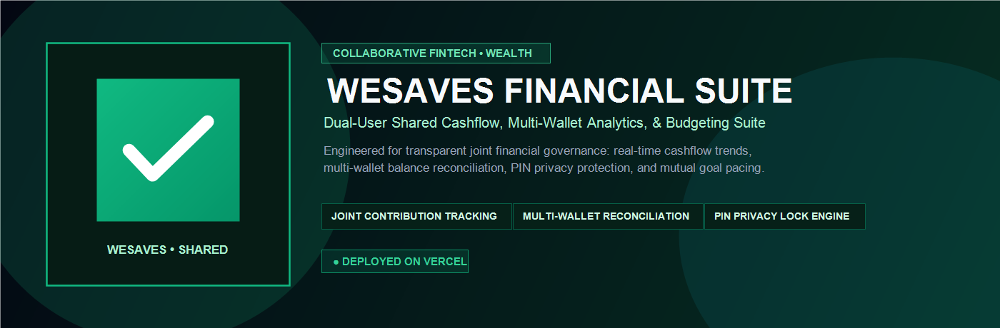

<div align="center">



# WESAVES FINANCIAL PLATFORM
### Collaborative Cashflow Tracking &bull; Multi-Wallet Balance Management &bull; Shared Wealth Architecture

[](https://we-saves.vercel.app)
[](https://we-saves.vercel.app)
[](https://we-saves.vercel.app)
[](https://github.com/faarimuhammad2502)

<br>

**A DUAL-USER PERSONAL FINANCE & JOINT CASHFLOW SUITE**  
*Conceived, architected, and engineered by Muhammad Faari Akbar*

[Launch Live Application](https://we-saves.vercel.app) &bull; [Inspect Source Code](https://github.com/faarimuhammad2502/we-saves)

</div>

---

## EXECUTIVE OVERVIEW

**WeSaves** is a collaborative personal finance and liquidity management platform engineered to resolve transparency friction in shared household budgeting, couples' joint savings, and individual cashflow tracking.

Unlike conventional single-user banking applications or bloated subscription-based personal finance software, WeSaves delivers an instantaneous, privacy-first interface. It combines **multi-wallet balance reconciliation, real-time spending category analytics, dual-user savings contribution splits, and PIN-secured privacy protection** into a single lightweight, zero-latency web application.

---

## CORE SYSTEM CAPABILITIES

### 1. DUAL-USER JOINT CONTRIBUTION ENGINE
* **Transparent Shared Milestones:** Distinct balance attribution allowing two partners or collaborators to track individual deposits toward mutual savings targets.
* **Progress Pacing:** Real-time percentage completion metrics against user-defined capital goals.

### 2. MULTI-WALLET CONSOLIDATION & RECONCILIATION
* Consolidated asset tracking across multiple financial silos: Traditional Commercial Banks, Digital E-Wallets, and Cash on Hand.
* Real-time net liquidity calculations updating instantly upon every debit or credit transaction.

### 3. NATIVE CASHFLOW & SPENDING VISUALIZATION
* **Algorithmic Trendlines:** In-browser responsive SVG line charts rendering multi-period cashflow trajectories without third-party graphing library overhead.
* **Categorical Expenditure Allocation:** Interactive expense segmentation tracking lifestyle, necessities, utilities, and emergency reserves.

### 4. PIN SECURITY & PRIVACY LOCK ENGINE
* Dedicated in-app PIN authentication screen (*"WeSaves Terkunci"*) preventing unauthorized visibility of account balances during over-the-shoulder usage.
* Session timeout safeguards with local cryptographic state verification.

### 5. DYNAMIC BUDGET THRESHOLDS
* Configurable monthly budget limits per category with immediate proactive visual indicators before expenditure thresholds are breached.

---

## TECHNICAL ARCHITECTURE & STACK

Engineered with a focus on speed, data privacy, and minimal battery consumption on mobile devices:

* **Frontend Engine:** Semantic HTML5, Tailwind CSS with high-contrast dark emerald aesthetic, and modular ES6+ JavaScript.
* **Visualization Layer:** Zero-dependency, GPU-accelerated inline SVG coordinate mapping for chart rendering.
* **Storage & Privacy:** Localized persistent client caching ensuring user financial data never traverses untrusted third-party analytical trackers.
* **Hosting Infrastructure:** Globally routed on Vercel Edge Network.

---

<div align="center">

```
W E S A V E S   F I N A N C I A L   P L A T F O R M
TRANSPARENT COLLABORATION &bull; LIQUIDITY RECONCILIATION &bull; ZERO LATENCY
```

<sub>&copy; 2026 WeSaves. Conceived, designed, and developed by <b>Muhammad Faari Akbar</b>. All rights reserved.</sub>

</div>
